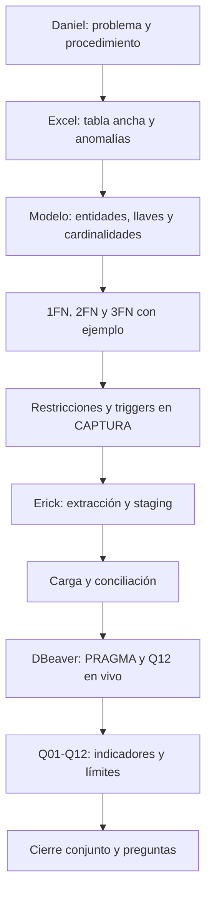
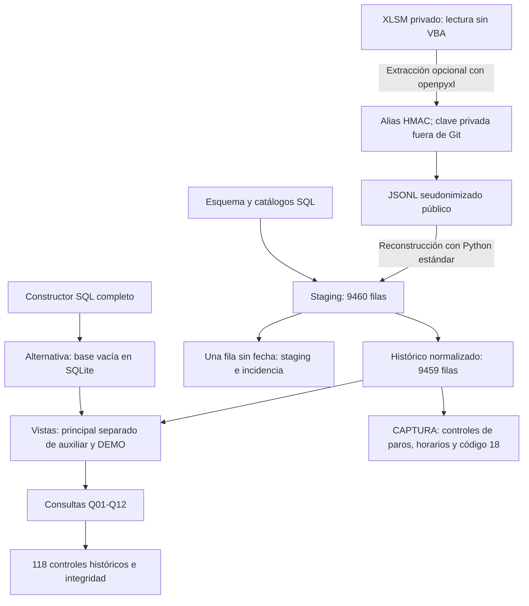

# Flujos para la exposición

## Recorrido oral

## Recorrido técnico

La reconstrucción habitual usa los datos seudonimizados del repositorio. No necesita el XLSM original, la clave HMAC, openpyxl ni ejecutar macros.
